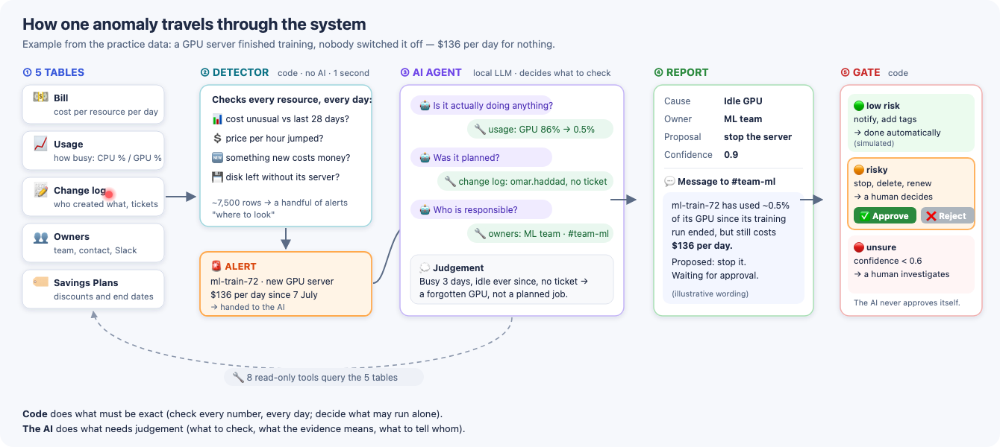

# FinOps Anomaly Agent — Report

An AI assistant that watches a company's daily cloud bill, finds unexpected costs, works out why they happened and
which team is responsible, and prepares the fix for a human to approve. Built and evaluated following CRISP-DM.
Full working log with every decision: [CRISP_DM.md](CRISP_DM.md) · how to run: [README](../README.md).

## 1. Business understanding

**Problem.** Cloud-cost anomalies (an idle GPU at ~$136/day, an expired discount, a forgotten disk) are often noticed
only on the monthly invoice, and investigating them is manual. AI tools for this exist — AWS Cost Anomaly Detection +
Amazon Q and the AWS FinOps Agent (Jun 2026, report only), Finout Agents (Jun 2026, detect → investigate → fix with
approval) — but none publishes how accurate it is, and lack of trust in automated outputs was the most-cited barrier
in a July 2026 study of 28 FinOps practitioners. **Our angle: build such an assistant and measure how far it can be trusted.**

**Requirements chosen for the scope**

| The system must… | Checked by |
|---|---|
| find anomalies in a daily FOCUS-format bill | detector catch rate, false alarms |
| explain each one: cause, responsible team, fix | agent accuracy vs answer key |
| never take a risky action without a human | risky actions without approval = 0 |
| ignore planned, approved cost increases | decoys dismissed |
| take every number from the data, not from the AI | tools compute numbers; AI quotes them |
| be free and run on a laptop; give the same answer twice | local model, fixed seed, reproducibility check |

**Out of scope:** real changes to AWS (all actions simulated), optimising the whole account, non-FOCUS formats.
**Runs on:** Mac with Apple Silicon, 16 GB RAM, ~5 GB disk, Ollama + Python; $0, no API key.

## 2. Data

No public dataset has months of one company's bill with labelled anomalies, so we built a realistic company from real ingredients:

| Source | Gave us |
|---|---|
| FOCUS Sample Data (FinOps Foundation, Sep 2024 bill, CC BY 4.0) | 21 real prices; the real **spending mix** (CPU servers 63.7%, GPU 23.0%, disks 4.8%, data transfer 3.0% …) |
| Azure VM trace 2019 (Microsoft, 2.7 M servers) | how busy normal servers are (median ~6% CPU) |
| 3 GPU-cluster papers (ATC'23, NSDI'24, OSDI'26) | how busy normal AI-serving GPUs are: 25% / 20% / 6% |

**DemoShop** — online shop with an AI recommendation engine: 6 teams, 8 AWS accounts, 38 resources, Mar–Aug 2026.

1. **Calibration.** First guesses were 4× off (too much storage and traffic). Databases + gateways (whole machines)
   cost $860/month = 4.3% of a real bill → total ≈ $20,300/month. Each group then gets its real share:
   `amount = real share × total ÷ real price`; rounding to whole servers gives 64.2% CPU instead of 63.7%.
2. **Daily bills:** `quantity = base × weekday pattern × growth × noise`, `cost = quantity × real price`.
3. **Five tables**, all derived from one daily state so they always agree: bill (FOCUS), usage metrics (CPU/GPU %),
   change log (who created what, tickets), owners, Savings Plans.
4. **Planted items:** idle GPU, data-transfer spike, data-transfer drift, untagged resource, expired Savings Plan,
   orphaned disk — plus **decoys** (planned increases with a ticket). Exact extra cost = cost with item − cost without
   item (same random noise).
5. **Difficulty** (things real data can't tell us are tested at three levels): normal GPU load 25 / 20 / 6%,
   noise ×0.33 / ×1 / ×2, spike ×10 / ×3 / ×1.5.
6. **15 datasets** = 3 difficulties × 5 scenarios (7–12 items each, varying on purpose), 147 labelled items.
   Scenarios 1–2 = practice; 3–5 = **sealed final exam**. Automatic tests prove the agent never reads the answer key.

## 3. System

| Component | Purpose | Input → output | Model / tool calls |
|---|---|---|---|
| ① Detector | find suspicious resources | 5 tables → alerts | none — statistics |
| ② Agent | investigate one alert | alert + tools → incident form | local LLM (qwen2.5-coder 7B) + 8 read-only tools |
| ③ Action gate | keep risky actions under human control | form → status | none — plain code |

**Detector** — per resource, per day: `normal = median of last 28 days`, `spread = 1.4826 × median distance from
normal`, alert if `(today − normal) / spread > 3` for 2 days and the extra cost ≥ $0.50/day (Z, K, $min tuned on
practice data). Extra rules: price per unit +5% (expired discount), new resource, disk whose server was deleted.

**Agent** — for each alert it decides which tool to call (resource info, cost history, usage, change log, owner,
Savings Plans, attached server, free read-only SQL), reads the result, repeats, then fills a fixed form: type ·
owner team · action · confidence · explanation · evidence · message to the owner. Its instructions: data
dictionary + FinOps playbook. It never sees the answers and never acts itself.

**Gate** — confidence < 0.6 or type "other" → human; stop / delete / renew → waits for Approve; notify / tag → automatic (simulated).

**Example (expired Savings Plan):** detector: web servers' price $0.238 → $0.340/h on 1 July, hours unchanged →
agent: price +42.9%, plan ended 1 July, managed by platform, no ticket → form: `sp_expired`, platform,
`recommend_sp_renewal` → gate: waits for approval.

## 4. Modeling decisions

**Model choice** (20 SQL questions on practice data; correct = same rows as the reference query):

| Model (maker) | Schema only | + data dictionary | Seconds |
|---|---|---|---|
| **qwen2.5-coder 7B (Alibaba)** | 40% | **80%** | **2.2** |
| qwen3 8B (Alibaba), thinking | 75% | 80% | 21.1 |
| llama3.1 8B (Meta) | 40% | 70% | 2.5 |

Describing each column in one line doubled accuracy; step-by-step reasoning didn't help. Chosen: qwen2.5-coder (best and fastest).

**Agent versions** (practice data, same detector): v1 free choice of tools → 67% fully right; v2 code-forced checklist
→ 33% (more evidence confused the small model); **v3** free choice + tools that state changes plainly ("GPU 86% → 0.5%")
+ resource kind in the alert → best on average (64%), frozen. Seed fixed so the same alert gives the same answer.

## 5. Evaluation — final exam (sealed scenarios 3–5, run once)

| (19 anomalies + ~10 decoys per difficulty) | Easy | Medium | Hard |
|---|---|---|---|
| Did it **find** the anomaly? | 18 / 19 | 18 / 19 | 12 / 19 |
| Did it **fully understand** it? (right cause + team + fix) | 14 / 19 | 12 / 19 | 11 / 19 |
| Did it leave **harmless** changes alone? | 13 / 18 | 14 / 18 | 13 / 18 |
| Risky actions **without a human** | **0** | **0** | **0** |
| Agent "real problem or not?": precision / recall / F1 | 0.79 / 0.86 / 0.83 | 0.83 / 0.91 / 0.87 | 0.74 / 0.88 / 0.80 |

**Why the scores aren't higher**

- *Detector misses* only on hard data: data-transfer changes of $0.3–1.3/day hidden in ±30% noise (below the $0.50 line by design).
- *Agent mistakes:* spike vs drift confused; legitimate new servers without a ticket sometimes called a problem;
  once it reasoned backwards ("finished earlier than the ticket said → unusual").
- *Confidence is not trustworthy:* wrong answers often came with 0.9–1.0 — so the decision to act is made by code.
- *Small sample:* 19 anomalies per difficulty; one anomaly ≈ 5 points.

**Trust conclusion.** With a free local 7B model the assistant is reliable enough to **find, explain and route**
anomalies and to run **low-risk** actions alone. **Risky actions must stay behind human approval.**

**Integrity:** detector, model and agent were developed on practice data only (checked by code before the final run);
results carry a SHA-256 fingerprint of the frozen code; re-running investigations reproduced them exactly (3/3).

**Not yet evaluated / next steps:** quality of the written explanations (LLM judge calibrated on hand labels);
the "just ask the LLM, no detector" baseline; a larger model; fixed command templates for real execution.

## 6. CRISP-DM and the AI coding assistant

| Phase | What happened |
|---|---|
| Business understanding | problem, market scan, requirements, metrics |
| Data understanding | FOCUS sample + Azure trace + GPU papers; gaps found |
| Data preparation | calibrated synthetic company, 5 tables, 15 labelled datasets, validation |
| Modeling | detector (tuned), model benchmark (2 rounds), agent v1 → v3, gate |
| Evaluation | per-component metrics on practice data, final exam once |
| Deployment | Streamlit app (presentation + live demo with trace and Approve/Reject), README |

Built with **Claude Code**, steered by files rather than chat alone: `CLAUDE.md` (rules loaded every session:
CRISP-DM order, stop for approval, every number needs a source, the agent never sees answers), two skills
(`add-data-step`, `evaluate-component`), automatic leak tests, and this log as the single source of truth.
Each rule came from a real mistake (e.g. guessed traffic amounts were 4× off → "every number needs a source").
